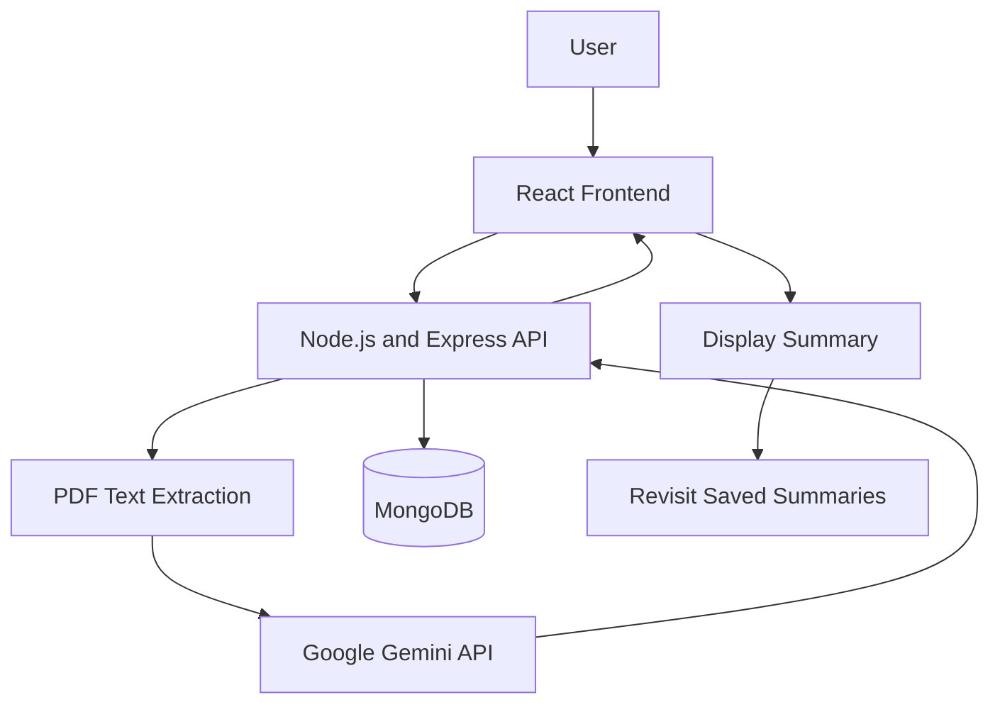

# MediClarity — AI Medical Report Summariser

MediClarity is a full-stack web application that helps people understand complex medical reports in simpler language. Users can upload a medical report, extract its text, generate an AI-powered summary, and save summaries so they can revisit them later.

> **Important:** MediClarity is an informational tool. AI-generated summaries may contain errors and are not a diagnosis or a substitute for advice from a qualified healthcare professional.

## 🌐 Project Links

- **Live Website:** https://mediclarity-fe.vercel.app/
- **Main GitHub Repository:** https://github.com/Ayush31104/Medical_Health_Summariser
- **Backend Repository:** https://github.com/Project31104/mediclarity-be
- **Frontend Repository:** https://github.com/Project31104/mediclarity-fe

## ✨ Features

- **Medical report upload** — Upload a medical report through the website.
- **PDF text extraction** — Extract report text using `pdf-parse` for processing.
- **AI-powered summarisation** — Use the Google Gemini API to turn complex report content into a more readable summary.
- **Simple explanations** — Make medical terminology and report details easier for non-specialists to understand.
- **User authentication** — Sign up and log in to access the application.
- **Saved summaries** — Store generated summaries in MongoDB and revisit them later.
- **Full-stack architecture** — React frontend communicates with a Node.js/Express backend.
- **Deployed application** — Frontend and backend are deployed for online access.

## 🧰 Technology Stack

| Area | Tools and technologies |
|---|---|
| Frontend | React, Vite, JavaScript, Tailwind CSS |
| Backend | Node.js, Express.js |
| Database | MongoDB, Mongoose |
| AI summarisation | Google Gemini API |
| Document processing | `pdf-parse` |
| Authentication | JSON Web Tokens (JWT) |
| API testing | Postman |
| Development | Visual Studio Code, npm |
| Version control | Git, GitHub |
| Deployment | Vercel (frontend); backend deployment configured separately |

## 🏗️ How It Works

1. **Upload:** The user uploads a medical report through the web interface.
2. **Extract:** The backend extracts readable text from the PDF.
3. **Summarise:** The extracted content is sent to the Gemini API to generate a simplified summary.
4. **Display:** The generated summary is returned to the frontend and shown to the user.
5. **Save:** The summary is stored in MongoDB for later access by the authenticated user.



## 📁 Project Structure

The frontend and backend are maintained in separate repositories. The following is a **high-level structure**; filenames may vary from the current implementation.

```text
MediClarity/
├── frontend/
│   ├── public/
│   ├── src/
│   │   ├── components/       # Reusable UI components
│   │   ├── pages/            # Application pages
│   │   ├── assets/           # Images and other static assets
│   │   └── ...               # App entry point, styles, and utilities
│   ├── index.html
│   ├── package.json
│   └── vite.config.js
│
├── backend/
│   ├── src/
│   │   ├── middleware/       # Upload and request middleware
│   │   ├── routes/           # API routes
│   │   ├── ...               # Controllers, models, and configuration
│   │   └── ...
│   ├── package.json
│   └── .env                  # Local environment variables (not committed)
│
└── README.md
```

## 🚀 Run Locally

### Prerequisites

- Node.js and npm
- A MongoDB database (local MongoDB or MongoDB Atlas)
- A Google Gemini API key
- Git

### 1. Clone the repository

```bash
git clone https://github.com/Ayush31104/Medical_Health_Summariser.git
cd Medical_Health_Summariser
```

If your frontend and backend are in separate repositories, clone each repository using the links in **Project Links** and run the commands from the corresponding project directory.

### 2. Install dependencies

Run this in each application directory:

```bash
npm install
```

### 3. Configure environment variables

Create a `.env` file in the backend directory and add the variable names expected by your backend configuration. Common examples are shown below; **use the exact names referenced in your code**.

```env
PORT=5000
MONGODB_URI=your_mongodb_connection_string
GEMINI_API_KEY=your_gemini_api_key
JWT_SECRET=your_long_random_secret
```

If your application uses different variable names, use those names instead. Do not commit `.env` files or expose API keys, database credentials, or JWT secrets in frontend code or GitHub.

### 4. Start the backend

From the backend directory, run the development command defined in its `package.json`, for example:

```bash
npm run dev
```

If there is no `dev` script, use the script listed in `package.json`.

### 5. Start the frontend

From the frontend directory, run:

```bash
npm run dev
```

Open the local URL printed by Vite in your terminal.

## 🔐 Security and Privacy Notes

- Keep API keys, database connection strings, and JWT secrets in environment variables.
- Never commit `.env` files or other secrets to source control.
- Protect saved reports and summaries with authentication and appropriate server-side access checks.
- Medical reports contain sensitive personal information. Upload only documents you are authorised to use, and review the application's privacy practices before uploading real patient data.

## ⚕️ Medical Disclaimer

MediClarity is designed to help users read and understand medical report content. It does **not** provide a medical diagnosis, replace a doctor's evaluation, or prescribe treatment. AI-generated content can be incomplete or inaccurate. Always consult a qualified healthcare professional before making medical decisions.

## 👨‍💻 Author

**Ayushman Behera**

- GitHub: https://github.com/Ayush31104
- LinkedIn: https://www.linkedin.com/in/ayushman-behera-44664228b/

---

If you find a problem or have a suggestion, open an issue in the relevant GitHub repository.
